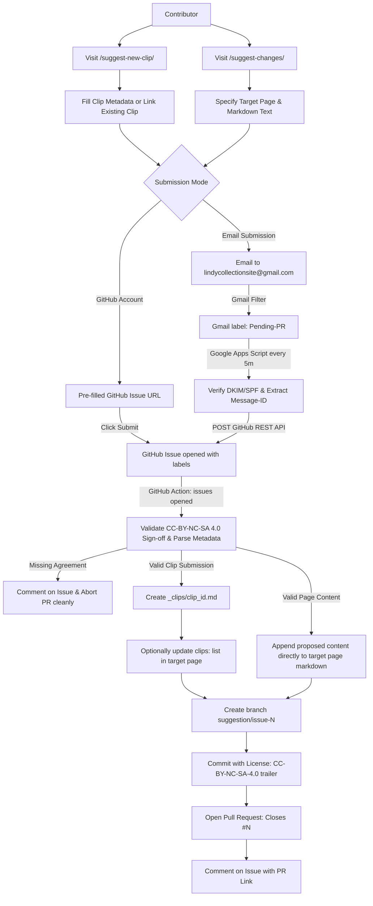

# Dual-Mode Content Submission Setup Guide

This guide describes how to configure and maintain the dual-mode content submission pipeline for [www.lindycollection.com](https://www.lindycollection.com).

---

## 🏗️ Architecture Overview

The pipeline allows both technical contributors (with GitHub accounts) and non-technical community members (via email) to submit suggestions with mandatory **CC-BY-NC-SA 4.0** legal attribution matching the rest of the site.

The site provides **two separate, dedicated submission pages**:
1. 🎬 **New Clip Submission Form** ([`/suggest-new-clip/`](https://www.lindycollection.com/suggest-new-clip/)): Dedicated form for submitting new YouTube clips with structured metadata (`clip_id`, `youtube_id`, `title`, timestamps, type, event) or linking an existing clip to an existing page.
2. 📝 **Page Content Suggestion Form** ([`/suggest-changes/`](https://www.lindycollection.com/suggest-changes/)): Dedicated form for proposing new markdown text or corrections directly to the body of any site page.

---

## 📋 The Two Dedicated Submission Pages

### 1. 🎬 Clip Submission ([`/suggest-new-clip/`](https://www.lindycollection.com/suggest-new-clip/))
Designed exclusively for submitting video clips or linking existing clips to routines, aerials, or moves.
- **New Clip Mode**:
  - `contributorName` (Required)
  - `clipYoutubeUrl` / `youtube_id` (Required): Full YouTube URL or ID with auto-timestamp parsing.
  - `clipId` (Required): Short name, lowercase_underscored (e.g. `ch_2019_basket_toss`).
  - `clipTitle` (Required): Descriptive title.
  - `targetPage` (Optional): Page URL to associate clip with (e.g. `/routines/big_apple/`).
  - `clipType` (Optional): `performance`, `tutorial`, `social`, `interview`, `historical`.
  - `startTime` / `endTime` (Optional): Seconds or `MM:SS` format (e.g. `1:30` -> `90`).
  - `event` (Optional): Event identifier matching `_events/` (e.g. `camp_hollywood_2019`).
  - `clipNotes` (Optional): Dancer identities, combinations, or notes.
- **Link Existing Clip Mode**:
  - `existingClip` (Required): Short name of clip already on site (e.g. `ch_2017_big_wheel`).
  - `targetPage` (Required): Target page URL (e.g. `/routines/big_apple/`).
  - `linkNotes` (Optional): Rationale or placement details.

**Automated PR Action**:
- For **New Clip**: Automatically generates `_clips/<clip_id>.md` ready to be merged, and if `target_page` matches an existing page file, appends `clip_id` to that page's `clips:` frontmatter list.
- For **Link Existing Clip**: Automatically appends the clip to `clips:` in the target page's frontmatter.

### 2. 📝 Page Content Suggestion ([`/suggest-changes/`](https://www.lindycollection.com/suggest-changes/))
Designed exclusively for proposing new markdown text for the body of any site page.
- `contributorName` (Required)
- `targetPage` (Required): URL or section of the page to update (pre-filled via `?page=`).
- `summary` (Required): Brief summary of the proposed addition.
- `content` (Required): Proposed markdown content for the page body.

**Automated PR Action**:
- Resolves the target page matching `targetPage` (e.g., `historical_figures.md`, `_routines/big_apple.md`, `about.md`), and proposes appending the submitted markdown content directly to the target page's markdown body. Maintainers review the proposed addition as a clean GitHub PR diff directly on the target page.

---

## 🔑 Step 1: Generate a Fine-Grained GitHub Personal Access Token (PAT)

To allow Google Apps Script to create GitHub Issues on behalf of email submissions without exposing broad repository access:

1. Go to GitHub **Settings** > **Developer settings** > **Personal access tokens** > **Fine-grained tokens**.
2. Click **Generate new token**.
3. Configure the token:
   - **Token name**: `LindyCollection-Gmail-Submission-Bridge`
   - **Expiration**: 1 year (or as preferred; set a renewal calendar reminder)
   - **Resource owner**: `lindycollection`
   - **Repository access**: **Only select repositories** > choose `lindycollection/www.lindycollection.com`
   - **Permissions**:
     - Under **Repository permissions**, find **Issues**.
     - Set **Issues** to **Read and write**.
     - Leave all other permissions as *No access*.
4. Click **Generate token** and copy the resulting `github_pat_...` string.

---

## 📬 Step 2: Configure the Gmail Filter

In the Gmail account receiving submissions (`lindycollectionsite@gmail.com`):

1. Open Gmail **Settings** (gear icon) > **See all settings**.
2. Navigate to the **Filters and Blocked Addresses** tab.
3. Click **Create a new filter**.
4. In the filter criteria:
   - **Subject**: `[Site Suggestion]`
5. Click **Create filter**.
6. Check the following actions:
   - ✅ **Apply the label:** Choose `New label...` and enter `Pending-PR`
   - ✅ **Never send it to Spam**
7. Click **Create filter**.

---

## ⚡ Step 3: Deploy the Google Apps Script

1. Navigate to [Google Apps Script](https://script.google.com/) while signed into the submission Gmail account.
2. Click **New project** and name it `Lindy Collection Submission Bridge`.
3. Replace the contents of `Code.gs` with the contents of [`scripts/gmail-to-github.gs`](../scripts/gmail-to-github.gs).
4. Save the file (`Ctrl+S` or disk icon).

### Add Script Properties (Environment Variables)
1. In the left sidebar, click the **Project Settings** (gear icon ⚙️).
2. Scroll down to **Script Properties** and click **Edit script properties** > **Add script property**.
3. Add the following property:
   - **Property**: `GITHUB_TOKEN`
   - **Value**: The Fine-Grained PAT generated in Step 1 (`github_pat_...`).
4. (Optional) If submitting to a different fork or test repository:
   - **Property**: `REPO_OWNER` | **Value**: `<github-owner>`
   - **Property**: `REPO_NAME` | **Value**: `<github-repo>`
5. Click **Save script properties**.

### Run Initial Authorization
1. Switch back to the **Editor** (`< >` icon).
2. Select `processPendingSuggestions` in the function dropdown at the top.
3. Click **Run**.
4. Grant the required permissions.
5. Check the **Execution log** to verify clean completion.

---

## ⏱️ Step 4: Enable the 5-Minute Time-Driven Trigger

1. In Google Apps Script, click **Triggers** (alarm clock icon ⏰) in the left sidebar.
2. Click **+ Add Trigger** (bottom right).
3. Configure the trigger:
   - **Function to run**: `processPendingSuggestions`
   - **Event source**: `Time-driven`
   - **Type of time based trigger**: `Minutes timer`
   - **Minute interval**: `Every 5 minutes`
4. Click **Save**.

---

## 🧪 Testing the Pipeline End-to-End

### 1. Test Clip Submission
1. Open [`/suggest-new-clip/`](https://www.lindycollection.com/suggest-new-clip/).
2. Select **Submit a New Clip** or **Link an Existing Clip**.
3. Fill in the metadata, accept the **CC-BY-NC-SA 4.0** license, and choose **Submit via GitHub Issue** (or email).
4. Verify the GitHub Action runs, validates the license, and opens a PR creating `_clips/<clip_id>.md`.

### 2. Test Page Body Content Submission
1. Open [`/suggest-changes/?page=/about/`](https://www.lindycollection.com/suggest-changes/?page=/about/).
2. Propose markdown changes, accept the **CC-BY-NC-SA 4.0** license, and submit.
3. Verify the GitHub Action opens a PR proposing to append the submitted markdown directly to `about.md`.
